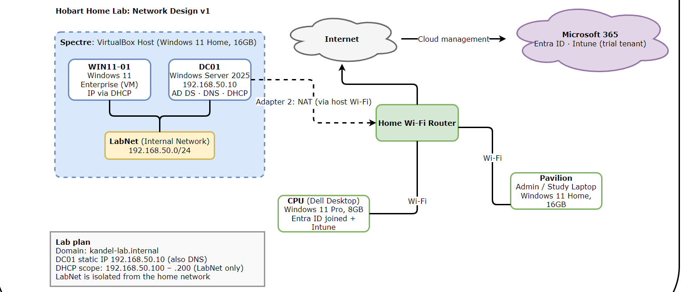

# Windows Server 2025 Domain Lab

A self-hosted Active Directory lab built on VirtualBox, documented from design through to
the faults encountered and how each one was diagnosed and fixed.

The point of this repository is not the build itself, which is a well-trodden path. It is the
record of the decisions and the troubleshooting: what broke, what evidence was used to work out
why, what the root cause turned out to be, and how the fix was verified.

**Author:** Gyanendra Kandel · Hobart, Tasmania

The lab has been running since September 2026. The documentation was kept in local files
until now; this repository publishes it and is updated as the build continues.

---

## Contents

| Path | What it holds |
|---|---|
| [`docs/build-log.md`](docs/build-log.md) | Session-by-session log, including three documented faults and their root causes |
| [`docs/reference.md`](docs/reference.md) | Names, addresses, virtual machine specifications and evaluation expiry dates |
| [`diagrams/`](diagrams/) | Network design, drawn in draw.io |
| `screenshots/` | Milestone screenshots |

---

## Architecture

Three physical machines, each with a fixed role, and an isolated virtual network inside the
hypervisor. There is no spare router and no ethernet link available between the machines, so
the lab network is entirely virtual and does not touch the home network at all.

| Component | Role |
|---|---|
| Hypervisor host | VirtualBox 7.2.18 on Windows 11, hosting both lab virtual machines |
| `DC01` | Windows Server 2025 Standard (Desktop Experience). AD DS, DNS, DHCP. Static `192.168.50.10` |
| `WIN11-01` | Windows 11 Enterprise client. Takes an address from DHCP, then joins the domain |
| Physical endpoint | A separate desktop, Entra ID joined and Intune enrolled over Wi-Fi |

| Setting | Value |
|---|---|
| Domain | `kandel-lab.internal` |
| NetBIOS name | `KANDEL-LAB` |
| Lab subnet | `192.168.50.0/24`, VirtualBox internal network `LabNet` |
| DHCP scope | `192.168.50.100` – `192.168.50.200`, on `LabNet` only |
| DNS | `192.168.50.10` — `DC01` pointing at itself |
| Gateway | None. `LabNet` is isolated by design |
| Internet | A second adapter on `DC01` using NAT, for updates and activation only |

Diagram source: [`diagrams/network-design-v1.drawio`](diagrams/network-design-v1.drawio), which
opens in [draw.io](https://app.diagrams.net).

---

## Design decisions

### Why `.internal` rather than `.local` or `.corp`

ICANN formally reserved the `.internal` top-level domain in 2024 for private networks. It is
guaranteed never to be delegated on the public internet, so an internal domain using it cannot
collide with a real website.

This replaces the older `.local` and `.corp` advice. `.local` conflicts with multicast DNS, which
macOS and Linux use for service discovery, and `.corp` was a live applicant for a public
top-level domain, which would have broken every internal network using it. Both caused
long-running name-collision problems.

The domain name was fixed **before** promotion. Renaming an Active Directory domain afterwards is
a disruptive operation that most organisations avoid entirely, so it is worth getting right once.

### Why a second NAT adapter rather than bridging to the home network

The lab runs DHCP. A DHCP server reachable from the home network would start answering requests
from real devices and hand out addresses on a subnet with no gateway, taking those devices
offline. Keeping `LabNet` as an isolated internal network makes that impossible by construction.
The second adapter gives `DC01` outbound internet for Windows Update and activation without ever
exposing the lab services inbound.

### Why virtual machine files are kept out of cloud sync

A virtual hard disk is tens of gigabytes and is rewritten continuously while the machine is
running. Syncing it would exhaust the storage quota and risks the sync client locking the file
while the hypervisor has it open. Disk images and ISOs stay on local storage; only documentation
is synced.

---

## Status

**Complete**

- Lab design, network diagram and domain naming decision
- `DC01` built and Windows Server 2025 Standard (Desktop Experience) installed
- `WIN11-01` built with UEFI, Secure Boot and TPM 2.0 enabled
- `DC01` on static `192.168.50.10`, AD DS installed and promoted for `kandel-lab.internal`
- DNS serving the domain, with the domain controller's records registered correctly
- DHCP scope `192.168.50.100`–`200` on `LabNet`, authorised in Active Directory
- Organisational unit structure `KANDEL-LAB\{Users, Computers, Groups}`, with domain users created
- `WIN11-01` renamed, joined to the domain, leasing from DHCP, and signing in as a domain user

**In progress**

- Security groups and Group Policy Objects
- Guest Additions on `DC01`

**Planned**

- Entra ID join and Intune enrolment for the physical endpoint
- A ticketing system with populated ticket history and knowledge-base articles
- A SIEM, with simulated attacks run strictly inside the lab

---

## Documentation standards

- One build-log entry per session: what was done, what broke, how it was resolved, what comes next.
- Every fault recorded as symptom, diagnosis, root cause, fix, and what it taught.
- Explanations written in my own words rather than copied, so the reasoning can be defended out loud.
- Screenshots captured at each milestone.

**No credentials appear anywhere in this repository.** Passwords live in a password manager only.
The reference sheet records what things are called and where they are, never how to sign in to them.
